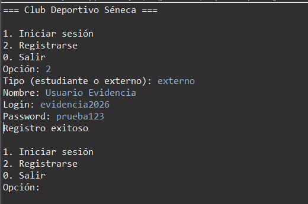
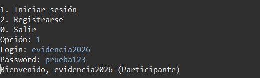
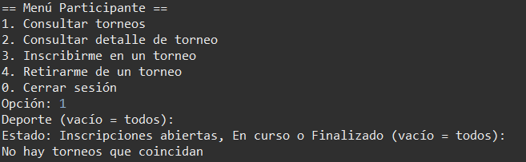
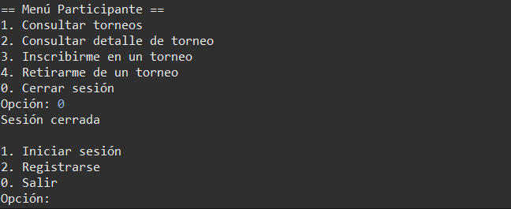
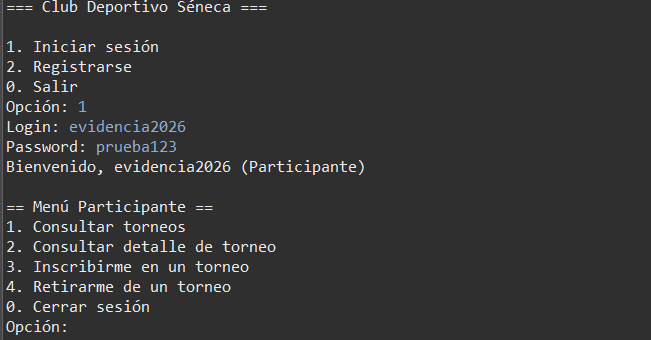
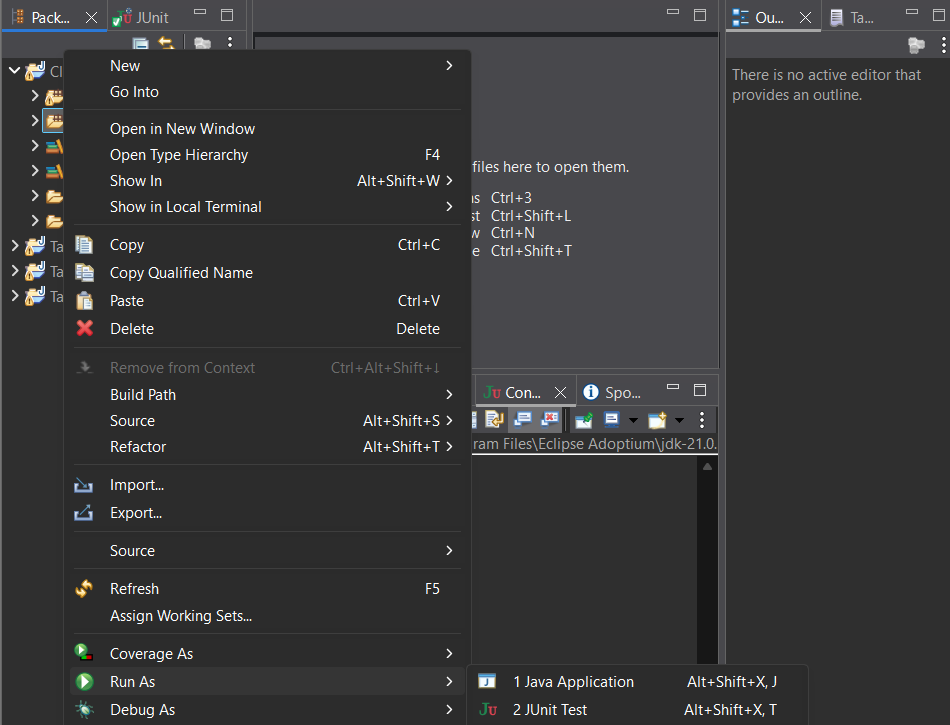
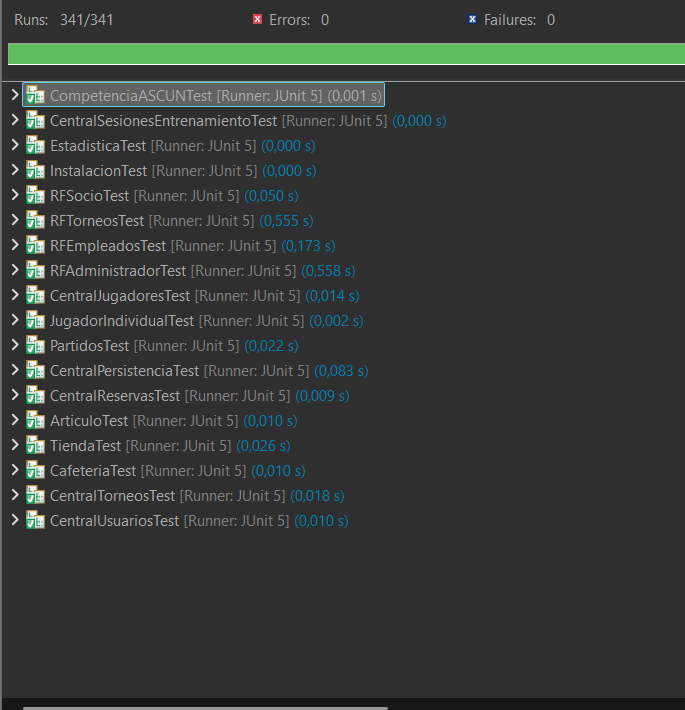

| Integrante | Código |
| --- | --- |
| David Triana | 202410344 |
| David Herrera | 202314421 |
| David Martínez Jaramillo | 202513297 |

# Proyecto #2 - Entrega Única — Club Deportivo Séneca

**Diseño y Programación Orientada a Objetos (ISIS-1226) — Universidad de los Andes**

## Descripción

Esta es la continuación del Proyecto 1. Tenemos una aplicación de consola desarrollada en **Java 17** para administrar diferentes actividades del Club Deportivo Séneca: usuarios, equipos, jugadores, turnos de empleados, instalaciones, reservas, entrenamientos, competencias, inventarios y ventas de la tienda y la cafetería.

Para el Proyecto 2 se añadieron los **torneos recreativos y competitivos**. El sistema permite crearlos, abrir inscripciones, inscribir jugadores, parejas o equipos según la modalidad, manejar cupos preferenciales, consultar resultados e historial y registrar premios. También incorporamos cuentas para estudiantes que no son socios y personas externas.

La aplicación separa los menús de consola de la lógica del sistema y utiliza archivos **JSON** para que la información se conserve cuando se cierra y vuelve a abrir.

## 1. Organización del proyecto

```text
Entrega única/
├── README.md
├── ClubSeneca/
│   ├── .project             Configuración de Eclipse
│   ├── .classpath           Rutas del código y las librerías
│   ├── src/                 Clases de la aplicación
│   ├── test/                Pruebas unitarias y de integración
│   ├── lib/                 Librerías JSON y JUnit
│   └── datos/               Información persistida en JSON
├── Docs/                    Documentación y diagramas
│   ├── UML/                 Diagramas de clases
│   └── colaboraciones/      Diagramas de colaboración
└── evidencias/
    └── pasos/               Capturas reales de ejecución y JUnit
```

La carpeta `src/` contiene, entre otros, los paquetes `interfaz`, `controladores`, `torneos`, `premios`, `persistencia`, `usuarios` y `excepciones`. Cada paquete agrupa clases relacionadas con una parte de la aplicación. Las pruebas están separadas del código en `test/`.

## 2. Requisitos y cómo abrirlo en Eclipse

Para ejecutar el proyecto necesitamos **JDK 17 o superior** y **Eclipse IDE for Java Developers**. No hace falta configurar Maven, Gradle ni una base de datos externa; los archivos `.jar` necesarios ya están incluidos en `lib/`:

- `json-20250517.jar`, para cargar y guardar datos JSON.
- `junit-platform-console-standalone-1.11.4.jar`, para ejecutar JUnit 5.

**Pasos para importar el proyecto:**

1. Descargar el repositorio en ZIP y descomprimirlo, o clonarlo desde GitHub.
2. Abrir Eclipse y elegir **File > Import > General > Existing Projects into Workspace**.
3. En **Select root directory**, seleccionar la carpeta `Entrega única/ClubSeneca`, que contiene el archivo `.project`.
4. Marcar el proyecto `ClubSeneca` y presionar **Finish**.
5. Si Eclipse muestra errores del JRE, revisar **Project > Properties > Java Build Path** y configurar JDK 17. El archivo `.classpath` ya referencia `JavaSE-17` y las dos librerías de `lib/`.

**Importante:** la carpeta de trabajo (*working directory*) debe ser `ClubSeneca`, porque ahí está `datos/`. Si no se cargan los archivos, revisar **Run > Run Configurations > Arguments > Working directory**.

## 3. Ejecutar la aplicación

Dentro de `src/interfaz/`, abrir una de las siguientes clases, hacer clic derecho y seleccionar **Run As > Java Application**:

| Clase `main` | Uso |
| --- | --- |
| `interfaz.CentralInterfaz` | Entrada general: inicio de sesión con cualquier rol y registro de estudiantes no socios o personas externas. |
| `interfaz.InterfazAdministrador` | Entrada para administradores. |
| `interfaz.InterfazSocio` | Entrada para socios. |
| `interfaz.InterfazEmpleado` | Entrada para entrenadores y fisioterapeutas. |
| `interfaz.InterfazParticipante` | Entrada para participantes de torneos, incluidos estudiantes no socios y externos. |

Las capturas de registro, sesión y persistencia se obtuvieron ejecutando **`interfaz.CentralInterfaz`**. Para las pruebas se utilizó **Run As > JUnit Test** sobre la carpeta `test/`.

Hay **cinco clases con `main`**; las entradas específicas permiten separar los perfiles aunque todos utilicen el mismo proyecto y la misma información. En los menús de inicio aparece `1. Iniciar sesión`, `0. Salir` y, cuando se admite el registro, `2. Registrarse`.

**Funciones principales por tipo de usuario:**

- **Administrador:** gestiona usuarios, equipos, inventarios, turnos, instalaciones, reportes y torneos; puede registrar encuentros, resultados y posiciones.
- **Empleado:** entrenador o fisioterapeuta; utiliza sus opciones de trabajo y puede participar en torneos individuales cuando cumple las condiciones. El entrenador tiene además funciones de sesiones, asistencia y desempeño.
- **Socio:** utiliza opciones de reservas, tienda/cafetería y torneos; puede consultar inscripciones, premios o bonos cuando corresponda.
- **Participante:** estudiante no socio o persona externa registrada para consultar, inscribirse o retirarse de torneos permitidos.

Para entrar con una cuenta que ya exista se solicita `Login` y `Password`. También se puede usar el registro de estudiantes o personas externas de la entrada general. No se requiere ingresar manualmente nombres de archivos al ejecutar el programa.

## 4. Ejemplos de ejecución y programas de prueba

Estos ejemplos muestran cómo se puede comprobar la aplicación. Los casos automatizados están en `test/` y las historias y requisitos están documentados en `Docs/`.

### 4.1 Registro de una persona externa e inicio de sesión (RF-TOR-06)

**Objetivo:** comprobar que se puede registrar un participante externo, iniciar sesión con su cuenta y consultar el menú de torneos.

**Paso 1. Registrar una cuenta.** Ejecutar `interfaz.CentralInterfaz`, elegir `2. Registrarse` y seleccionar el tipo `externo`. Ingresar nombre, login y contraseña de prueba. El sistema debe responder `Registro exitoso`.



**Paso 2. Iniciar sesión.** En el menú inicial, escoger `1. Iniciar sesión` e ingresar las credenciales que se acaban de registrar. El sistema debe identificar al usuario como `Participante`.



**Paso 3. Consultar torneos.** En el menú del participante elegir `1. Consultar torneos` y dejar los filtros vacíos. En esta ejecución el sistema mostró `No hay torneos que coincidan`. Esto permite comprobar que la consulta funciona y maneja el caso de no encontrar resultados.



**Paso 4. Cerrar sesión.** En el menú del participante, elegir `0`. Se muestra `Sesión cerrada` y vuelve el menú inicial. Después se puede elegir `0` nuevamente para salir del programa.



Las cuatro capturas anteriores corresponden a las acciones realizadas desde el menú de la aplicación.

### 4.2 Conservar los datos después de cerrar (persistencia)

**Objetivo:** comprobar que una cuenta nueva sigue disponible después de cerrar y volver a abrir la aplicación.

**Paso 1. Crear una cuenta nueva.** Realizar el registro del caso anterior.

**Paso 2. Cerrar normalmente.** Elegir `0` en el menú de participante para cerrar sesión y luego `0` en el menú inicial para salir. Al finalizar, la aplicación guarda los datos en archivos JSON.


**Paso 3. Volver a abrir.** Ejecutar nuevamente `interfaz.CentralInterfaz`, seleccionar `1. Iniciar sesión` e introducir el mismo login y contraseña, **sin volver a registrar la cuenta**.

**Paso 4. Comprobar el resultado.** El usuario debe iniciar sesión y acceder de nuevo al menú `Participante`. En la captura se observa que la cuenta registrada anteriormente puede iniciar sesión nuevamente después de reiniciar la aplicación.




### 4.3 Inscripción individual a un torneo (RF-TOR-07)

El sistema debe permitir la inscripción individual cuando el torneo acepta inscripciones, el jugador cumple el nivel requerido y existen cupos.

**Programa de prueba:** (1) Tener un torneo individual con inscripciones abiertas. (2) Iniciar sesión como socio o participante. (3) Seleccionar la opción de inscripción e indicar el torneo. (4) Verificar que la inscripción se guarde y se actualicen los cupos. (5) Intentar inscribirse de nuevo en el mismo torneo y comprobar que se rechace. (6) Intentar inscribirse en un torneo iniciado y comprobar el rechazo.

Estos escenarios también se comprueban en la clase `RFTorneosTest`.

### 4.4 Cupos preferenciales (RF-TOR-11 y RF-TOR-12)

El sistema reserva el **20 % de los cupos, redondeado hacia arriba**, para jugadores o equipos con mejor ranking de la categoría. Si corresponde liberar cupos preferenciales no utilizados, estos pasan a disponibilidad regular sin aumentar la capacidad total.

**Programa de prueba:** (1) Crear un torneo con 11 cupos. (2) Verificar que se calculen 3 cupos preferenciales. (3) Registrar participantes elegibles y comprobar que se asignen correctamente. (4) Comprobar que un participante no elegible no tome un cupo reservado antes de su liberación. (5) Liberar los cupos no ocupados según la lógica del programa. (6) Comprobar que la cantidad total sigue siendo 11.

Hay pruebas de estos casos en `test/integracion/RFTorneosTest.java` y diagramas de colaboración asociados.

### 4.5 Empleados y bonos (RF-TOR-13, RF-TOR-14 y RF-TOR-15)

**Programa de prueba:** (1) Comprobar que un entrenador o fisioterapeuta sin turno pueda inscribirse en un torneo individual y que, si es competitivo, su tarifa sea cero. (2) Comprobar que un empleado de turno no pueda inscribirse. (3) Finalizar un torneo recreativo y consultar el bono que recibió un ganador. (4) Utilizar el bono en una compra válida. (5) Verificar que no se pueda usar dos veces ni combinar con otros descuentos.

Los escenarios de estas funcionalidades están incluidos en las pruebas de integración de torneos.

## 5. Persistencia de la información

El proyecto utiliza archivos JSON dentro de `ClubSeneca/datos/`. Al iniciar, `CentralInterfaz.ejecutar(...)` crea el controlador principal y llama a `cargarInformacion()`; al terminar normalmente llama a `guardarInformacion()`. La clase `persistencia.CentralPersistencia` coordina las clases que leen y escriben cada sección.

Los archivos iniciales que vienen en el proyecto son `usuarios.json`, `club.json`, `equipos.json`, `jugadores.json`, `instalaciones.json`, `reservas.json`, `partidos.json`, `competencias.json`, `entrenamientos.json` y `tiendas.json`. Para los torneos también se utiliza `torneos.json`, que puede generarse al guardar si todavía no existe.

No hay que elegir archivos cada vez que se abre o cierra la aplicación. Si se quiere comprobar la persistencia sin alterar los datos principales, es recomendable copiar primero la carpeta `datos/`. Además, el programa admite indicar otra carpeta como primer argumento de su `main`.

## 6. Pruebas automáticas con JUnit 5

Las pruebas están en `ClubSeneca/test/`. Hay pruebas unitarias para clases de lógica y pruebas de integración para requerimientos funcionales de administrador, empleados, socios y torneos.

Para ejecutarlas desde Eclipse:

1. Abrir `ClubSeneca` y ubicar la carpeta `test`.
2. Hacer clic derecho en la carpeta y elegir **Run As > JUnit Test** (también se pueden ejecutar clases individuales).
3. Revisar la vista de JUnit para ver pruebas exitosas, fallidas y errores.

**Clases de integración:** `RFAdministradorTest`, `RFEmpleadosTest`, `RFSocioTest` y `RFTorneosTest` (paquete `integracion`). **Otras pruebas:** `CentralTorneosTest`, `CentralPersistenciaTest`, `CentralUsuariosTest`, entre otras.

**Resultado de la ejecución:** en Eclipse se ejecutaron **341 pruebas, las 341 exitosas, con 0 errores y 0 fallos**, como muestra la captura del paso siguiente. Si se cambia el código, se deben volver a ejecutar.

**Evidencia en Eclipse de las pruebas automatizadas:**

1. Ubicar las pruebas en `test/` y ejecutarlas desde Eclipse con **Run As > JUnit Test**. Otra opción es usar el ejecutor JUnit incluido en `lib/` desde la terminal, con el proyecto correctamente compilado.
2. En el menú contextual seleccionar **Run As > JUnit Test**:



3. Revisar el resumen de resultados. En la ejecución verificada se encontraron y ejecutaron **341 pruebas**; **341 tuvieron éxito** y **0 fallaron**.



Las capturas se tomaron en Eclipse: una muestra la opción para ejecutar JUnit y la otra el resultado de la vista JUnit. Si se modifica el código, es necesario repetir las pruebas y actualizar estas imágenes.


## 7. Diagramas del proyecto

Igual que en el Proyecto 1, los diagramas se dividieron por secciones para poder leerlos mejor. El archivo `diagramas.drawio` y `diagrama.drawio` contienen los diagramas editables. En el repositorio también están exportados como PNG en `Docs/UML/`.

### Torneos


[Ver diagrama detallado de Torneos](Docs/UML/diagrama_vistas_modificadas-Torneos%20%E2%80%93%20detallado.drawio.png)

### Premios


[Ver diagrama detallado de Premios](Docs/UML/diagrama_vistas_modificadas-Premios%20%E2%80%93%20detallado.drawio.png)

### Persistencia


[Ver diagrama detallado de Persistencia](Docs/UML/diagrama_vistas_modificadas-Persistencia%20%E2%80%93%20detallado.drawio.png)

### Otras secciones del sistema

También se incluyen las siguientes vistas; cada una tiene un diagrama de alto nivel y otro detallado:

- **Controladores:** [alto nivel](Docs/UML/diagrama_vistas_modificadas-Controladores%20%E2%80%93%20alto%20nivel.drawio.png) · [detallado](Docs/UML/diagrama_vistas_modificadas-Controladores%20%E2%80%93%20detallado.drawio.png)
- **Equipos:** [alto nivel](Docs/UML/diagrama_vistas_modificadas-Equipos%20%E2%80%93%20alto%20nivel.drawio.png) · [detallado](Docs/UML/diagrama_vistas_modificadas-Equipos%20%E2%80%93%20detallado.drawio.png)
- **Excepciones:** [alto nivel](Docs/UML/diagrama_vistas_modificadas-Excepciones%20%E2%80%93%20alto%20nivel.drawio.png) · [detallado](Docs/UML/diagrama_vistas_modificadas-Excepciones%20%E2%80%93%20detallado.drawio.png)
- **Interfaz:** [alto nivel](Docs/UML/diagrama_vistas_modificadas-Interfaz%20%E2%80%93%20alto%20nivel.drawio.png) · [detallado](Docs/UML/diagrama_vistas_modificadas-Interfaz%20%E2%80%93%20detallado.drawio.png)
- **Jugadores:** [alto nivel](Docs/UML/diagrama_vistas_modificadas-Jugadores%20%E2%80%93%20alto%20nivel.drawio.png) · [detallado](Docs/UML/diagrama_vistas_modificadas-Jugadores%20%E2%80%93%20detallado.drawio.png)
- **Partidos:** [alto nivel](Docs/UML/diagrama_vistas_modificadas-Partidos%20%E2%80%93%20alto%20nivel.drawio.png) · [detallado](Docs/UML/diagrama_vistas_modificadas-Partidos%20%E2%80%93%20detallado.drawio.png)
- **Persistencia:** [alto nivel](Docs/UML/diagrama_vistas_modificadas-Persistencia%20%E2%80%93%20alto%20nivel.drawio.png) · [detallado](Docs/UML/diagrama_vistas_modificadas-Persistencia%20%E2%80%93%20detallado.drawio.png)
- **Premios:** [alto nivel](Docs/UML/diagrama_vistas_modificadas-Premios%20%E2%80%93%20alto%20nivel.drawio.png) · [detallado](Docs/UML/diagrama_vistas_modificadas-Premios%20%E2%80%93%20detallado.drawio.png)
- **Tiendas:** [alto nivel](Docs/UML/diagrama_vistas_modificadas-Tiendas%20%E2%80%93%20alto%20nivel.drawio.png) · [detallado](Docs/UML/diagrama_vistas_modificadas-Tiendas%20%E2%80%93%20detallado.drawio.png)
- **Torneos:** [alto nivel](Docs/UML/diagrama_vistas_modificadas-Torneos%20%E2%80%93%20alto%20nivel.drawio.png) · [detallado](Docs/UML/diagrama_vistas_modificadas-Torneos%20%E2%80%93%20detallado.drawio.png)
- **Usuarios:** [alto nivel](Docs/UML/diagrama_vistas_modificadas-Usuarios%20%E2%80%93%20alto%20nivel.drawio.png) · [detallado](Docs/UML/diagrama_vistas_modificadas-Usuarios%20%E2%80%93%20detallado.drawio.png)

### Diagramas de colaboración

Los siguientes diagramas muestran interacciones entre objetos para funcionalidades nuevas:

- [RF-TOR-05: registro de estudiante no socio](Docs/colaboraciones/colaboraciones-RF-TOR-05%20Registrar%20estudiante%20no%20socio.drawio.png).
- [RF-TOR-12: liberación de cupos preferenciales](Docs/colaboraciones/colaboraciones-RF-TOR-12%20Liberacion%20de%20cupos%20preferenciales.drawio.png).

Son diagramas de diseño de la aplicación, no solamente un modelo conceptual del mundo del problema.

## 8. Documentación de análisis y diseño

En `Docs/` quedaron los materiales que se utilizaron para la evolución del proyecto:

- [NuevaInformacion.odt](Docs/NuevaInformacion.odt): historias nuevas, requerimientos funcionales, restricciones y persistencia.
- [Responsabilidades nuevas.ods](Docs/Responsabilidades%20nuevas.ods): tablas de responsabilidades y de cambios respecto al diseño anterior.
- [diagramas.drawio](Docs/UML/diagramas.drawio) y [diagrama.drawio](Docs/UML/diagrama.drawio): archivos editables de los diagramas de clases.
- [UML/](Docs/UML/): imágenes de alto nivel y detalladas.
- [colaboraciones/](Docs/colaboraciones/): imágenes de las interacciones de algunos requerimientos nuevos.

Estos documentos contienen el detalle de los requerimientos y decisiones de diseño. El README se concentra en explicar cómo ejecutar y comprobar el proyecto, sin repetir todo el documento de diseño.

## 9. Problemas comunes

- **Eclipse marca errores con `org.json` o JUnit:** comprobar que los dos `.jar` de `lib/` aparecen en el **Build Path**.
- **No encuentra el archivo de datos:** revisar el *working directory*; debe apuntar a `ClubSeneca` o proporcionar la ruta de datos como primer argumento.
- **Una cuenta no puede iniciar sesión:** revisar que el usuario exista, que la contraseña sea correcta y que se esté ejecutando una interfaz que admita su rol.
- **El registro dice que un login está repetido:** elegir otro login; no se permiten usuarios duplicados.
- **Los cambios de una prueba alteraron la información:** restaurar la copia de respaldo de `datos/`.
- **Los diagramas se ven pequeños en el README:** abrir los enlaces de PNG o los archivos `.drawio` desde `Docs/UML/`.

---

**Nota:** las siete capturas de esta carpeta corresponden a ejecuciones reales tomadas en Eclipse. Si el grupo actualiza la implementación antes de entregar, conviene repetir las pruebas y actualizar las evidencias.
